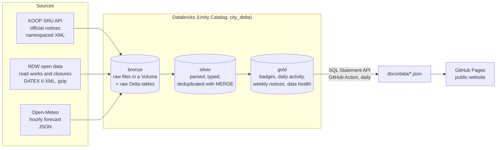

# CityDelta

**A daily Databricks lakehouse that combines three official Dutch open data sources into one model, published as a public map of The Hague.**

🔗 **Live site:** https://ammar-alsharai.github.io/city-delta/


---

## What it is and why

Information about what is changing in a city is public, but scattered. Municipal permits and traffic decisions are published by KOOP as namespaced XML. Road works and closures come from NDW as a national DATEX II feed. Weather comes from Open-Meteo as JSON. Each source has its own format, its own identifiers and its own idea of time.

CityDelta pulls all three into one Delta Lake model every morning, cleans and joins them, checks the data, and publishes the result as a public website where anyone can search an address and see what is happening around it.

It is a data engineering project first. The goal is a pipeline that is incremental, idempotent, tested, scheduled and documented, built the way a production pipeline would be.

## Architecture



One Databricks Job runs the ten notebooks every day at 06:00 (Europe/Amsterdam). The three ingests run in parallel, each source has its own silver step, and everything joins in gold.


At 06:40 UTC a GitHub Action queries the gold tables through the Databricks SQL Statement API, writes six small JSON files and commits them. GitHub Pages serves them to the website.

## Data sources

| Source | What it provides | Format | Licence |
|---|---|---|---|
| [Officiële bekendmakingen](https://www.officielebekendmakingen.nl/) (KOOP, SRU API) | Building and demolition permits, tree felling, event permits and traffic decisions, with coordinates | XML with namespaces | Open government data |
| [NDW Melvin](https://opendata.ndw.nu/) (planned road works and events feed) | Road works, closures and events on the road, nationwide | DATEX II v3 XML, gzip | CC0 1.0 |
| [Open-Meteo](https://open-meteo.com/) | Hourly forecast: temperature, rain chance, rain, wind | JSON | CC BY 4.0 |
| [PDOK](https://www.pdok.nl/) BRT Achtergrondkaart and Locatieserver | Basemap and address search on the website | Map tiles, JSON | CC BY 4.0 |

All requests send the User-Agent `CityDelta/1.0 (portfolio project)`. No data is scraped; every source is an official API or open data file.

## Data model

| Layer | Table | Grain | Built by |
|---|---|---|---|
| bronze | `sru_raw` | one row per notice, raw XML | `01_ingest_sru` |
| bronze | `weather_raw` | one row per city per day, raw JSON | `02_ingest_weather` |
| bronze | `ndw_raw` | one row per situation inside the city box, raw XML | `03_ingest_ndw` |
| silver | `notices` | one row per notice, with category and stage | `04_silver_notices` |
| silver | `road_works` | one row per NDW situation, with closure level | `05_silver_road_works` |
| silver | `weather_hourly` | one row per city per hour | `06_silver_weather` |
| silver | `city_happenings` | notices and road works in one shape, with distance from the centre | `07_silver_city_happenings` |
| gold | `happenings_enriched` | one row per happening, with badges (rain risk, closure nearby, permit only) | `08_gold_happenings` |
| gold | `daily_activity` | one row per city per day | `09_gold_aggregates` |
| gold | `permits_weekly` | one row per city, week, category and stage | `09_gold_aggregates` |
| gold | `data_health` | one row per quality check | `10_data_health` |

Raw files (XML pages, the NDW `.gz` file, the weather JSON) are also archived in the Unity Catalog Volume `city_delta.bronze.raw`, so silver can be rebuilt without calling the APIs again.

## Engineering decisions

- **Incremental loading.** The SRU ingest keeps a watermark (the last loaded day) and only asks for notices modified since then. The first run loads 30 days; a normal day loads a few dozen notices.
- **Idempotent writes.** Every bronze write deletes today's rows before appending, so re-running a notebook or retrying the Job never creates duplicates.
- **Deduplication with `MERGE`.** Silver tables merge on the source ID and only accept a newer version (`WHEN MATCHED AND s.version >= t.version`), so overlapping loads are safe.
- **Streaming a national file.** The NDW feed covers the whole country (about 14,000 situations). It is downloaded in 1 MB chunks and parsed with `ElementTree.iterparse`, keeping only situations inside the city's bounding box, so memory stays flat.
- **Config-driven.** The city, its centre and its radius live in `config/cities.yaml`. Adding a city is a config change, not a code change.
- **Explicit schemas and time zones.** Bronze tables use explicit `StructType` schemas. Local times are stored as `timestamp_ntz`, so weather hours and road works line up exactly.
- **Honest data, not invented data.** Notices only carry a publication date, so the model keeps `published_date` and `start_local`/`end_local` separate, with a `time_basis` column, instead of guessing event dates.
- **Safe publishing.** The export only writes files after every query has succeeded, and refuses to publish if any table returns too few rows, so the website keeps yesterday's data rather than showing an empty page.
- **Secrets stay secret.** The Databricks token lives in GitHub's encrypted secrets and is never committed or logged.

## Data quality

`10_data_health` runs 14 checks every morning and writes them to `gold.data_health`. The website shows them in the "Data checks" section.

| Check | Why |
|---|---|
| Hours since last load, per source | Catches a failed or skipped run |
| Rows in the last load | Catches an empty or broken API response |
| Duplicate IDs in silver | Proves the `MERGE` deduplication works |
| Age of the NDW file | Catches a stale upstream feed |
| Forecast days ahead | Catches a truncated weather response |
| Situations without coordinates or with an approximate location | Kept in the data, hidden from the map |
| Share of notices with an unknown stage | Tracks how well the title parsing works |


## Repository structure

```
city-delta/
├── config/cities.yaml            # city settings: name, centre, radius
├── notebooks/
│   ├── 00_setup                  # catalog, schemas and raw Volume (run once)
│   ├── 01_ingest_sru             # bronze: official notices
│   ├── 02_ingest_weather         # bronze: hourly forecast
│   ├── 03_ingest_ndw             # bronze: road works and closures
│   ├── 04_silver_notices
│   ├── 05_silver_road_works
│   ├── 06_silver_weather
│   ├── 07_silver_city_happenings
│   ├── 08_gold_happenings
│   ├── 09_gold_aggregates
│   └── 10_data_health
├── export/export_gold.py         # gold tables -> docs/data/*.json
├── .github/workflows/export.yml  # daily export, then GitHub Pages rebuild
├── docs/                         # the website (GitHub Pages)
│   ├── index.html
│   ├── assets/                   # app.js, style.css
│   └── data/                     # daily JSON export
└── tools/gen_sample.py           # sample data for working on the website offline
```

## How to run it

1. **Databricks.** Create a [Databricks Free Edition](https://www.databricks.com/learn/free-edition) workspace and add this repository as a Git folder.
2. **Setup.** Run `notebooks/00_setup` once. It creates the `city_delta` catalog, the `bronze`, `silver` and `gold` schemas and the raw Volume.
3. **Job.** Create a Job with one notebook task per notebook (dependencies as in the architecture above) on serverless compute, scheduled daily. Run it once by hand to fill every table.
4. **Export.** Create a Databricks personal access token and add three GitHub secrets: `DATABRICKS_HOST`, `DATABRICKS_TOKEN` and `DATABRICKS_WAREHOUSE_ID`. Run the **Daily data export** workflow once from the Actions tab.
5. **Website.** In the repository settings, enable GitHub Pages from the `main` branch, folder `/docs`.

## Limitations


- **Event permits are not confirmed events.** A permit shows that an event was applied for or approved, not that it will take place. No open, reliable source of upcoming events exists for The Hague.
- **Locations.** About 2 % of situations have a pin far from the search area (the average of a long route) or no coordinates at all. They are flagged by `location_ok` and kept off the map.
- **Stage from text.** Whether a permit was applied for, granted or refused is read from the notice title. About 20 % of titles don't say, and those show as "unknown".
- **One city.** The model supports several cities, but only Den Haag is configured.

## Next steps

- An official events feed, if the city's tourism agency or Ticketmaster grants data access
- Use the point nearest to the search centre for long NDW routes, instead of the average
- A Power BI report on the gold tables, through the Databricks connector
- More cities in `config/cities.yaml`

## Disclaimer and credits

CityDelta is an independent portfolio project, not affiliated with Gemeente Den Haag. Information only: always check the official source before relying on it.

Data: Officiële bekendmakingen (KOOP), NDW (CC0), weather data by [Open-Meteo.com](https://open-meteo.com/) (CC BY 4.0). Map: BRT Achtergrondkaart, © Kadaster via PDOK (CC BY 4.0). Address search: PDOK Locatieserver.

## Author

**Ammar Al-sharai** · The Hague, Netherlands
[LinkedIn](https://www.linkedin.com/in/ammar-al-sharai-00769a130/) · [GitHub](https://github.com/ammar-alsharai)
